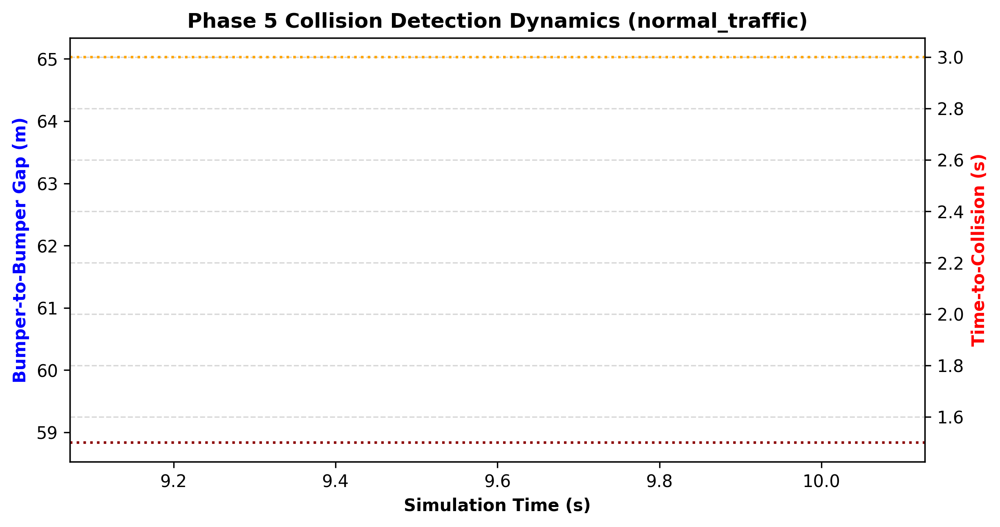
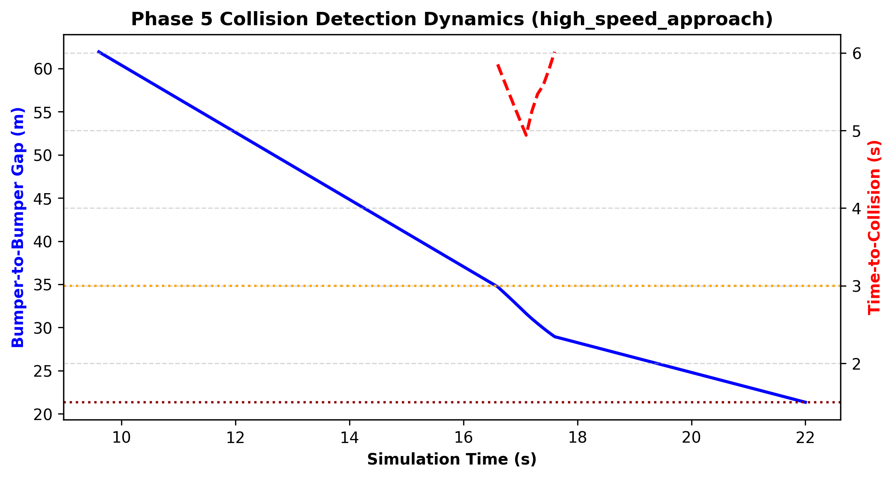
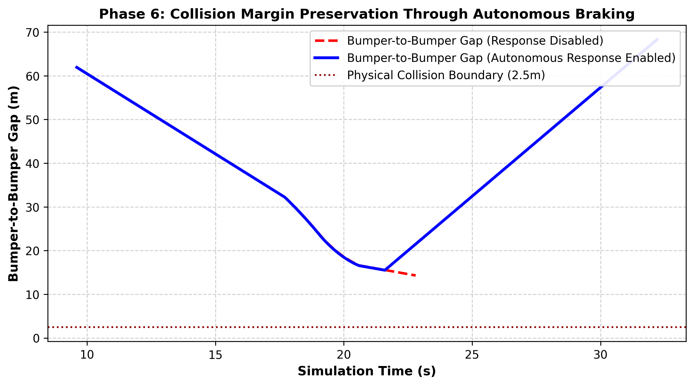
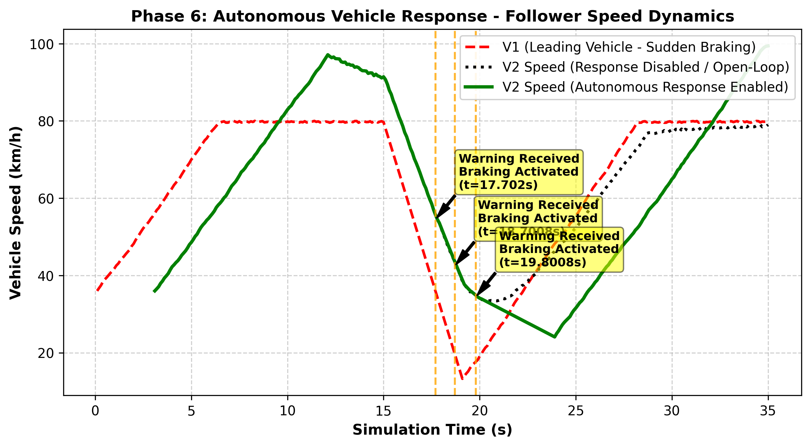
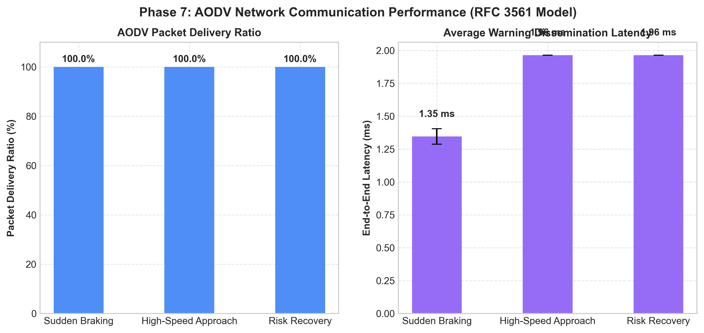
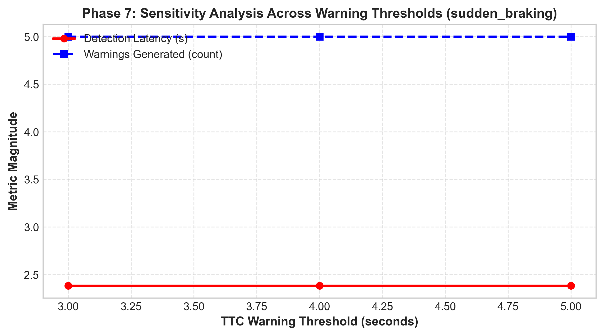

# VANET-Based Collision Warning and Traffic Management Using AODV Routing

## 1. Project Overview
Road traffic accidents often stem from delayed driver reaction to imminent collisions. This project investigates a vehicular ad‑hoc network (VANET) that detects high‑risk situations using vehicle telemetry, disseminates warning messages via an AODV‑style routing protocol, and triggers an autonomous braking response in the warned vehicle. The goal is to improve safety and traffic flow while providing a reproducible simulation platform for further research.

## 2. Key Features

| Feature | 
|---------|
| **Collision‑risk detection** – Time‑to‑collision (TTC), bumper‑to‑bumper gap and relative closing speed computed from SUMO vehicle states. |
| **Warning generation** – Structured warning messages (ID, sender/receiver, risk metrics, timestamp). |
| **Python‑based AODV routing** – Store‑and‑forward message propagation using a lightweight AODV implementation written in Python. |
| **Closed‑loop autonomous response** – Verified braking of the warned vehicle via SUMO TraCI when a warning is successfully received. |
| **Scenario‑based evaluation** – Six predefined traffic scenarios covering a range of risk conditions. |
| **Result logging & analysis** – CSV logs for vehicle states, warnings, network events, and post‑processing scripts (Pandas/Matplotlib). |
| **Web dashboard** – Streamlit UI to visualise logged metrics and figures. |

## 3. System Architecture

```
+----------------+      +----------------+      +-------------------+
|   SUMO (TraCI) |<---->|   Python Core  |<---->|  Python AODV Model |
|  (Mobility)    |      |  (Detection,   |      |  (Routing &       |
|                |      |   Warning,     |      |   Delivery)       |
+----------------+      |   Braking ctrl)|      +-------------------+
        ^               +----------------+                ^
        |                        ^                       |
        |                        |                       |
        |                +-------+-------+               |
        |                |  Streamlit UI |               |
        |                +---------------+               |
        +-----------------------------------------------+
```

1. **SUMO** provides real‑time vehicle telemetry via TraCI.
2. The **Python Core** computes collision risk, creates warning messages, validates receipt, and commands braking through TraCI.
3. The **Python AODV model** forwards warnings between vehicles using a simplified AODV protocol.
4. **Streamlit** reads the CSV logs and renders the figures stored under `final_results/figures/`.

## 4. Technology Stack

| Layer | Tools / Versions |
|-------|------------------|
| Traffic & Mobility | **SUMO** 1.19.0 (Windows) |
| Network Simulation | Custom **Python AODV** implementation (no native OMNeT++/INET/Veins integration validated) |
| Co‑simulation | **TraCI** Python bindings |
| Data Processing | **Python 3.11**, Pandas, NumPy, Matplotlib |
| Dashboard | **Streamlit** 1.32 |
| Version Control | Git |
| Build / CI (optional) | None (manual execution) |

## 5. Project Structure

```
VANET-Collision-Warning/
├─ dashboard/
│   ├─ app.py
│   ├─ charts.py
│   └─ data_loader.py
├─ documentation/
│   ├─ execution_guide.md
│   ├─ experiment_protocol.md
│   ├─ final_architecture.md
│   ├─ phase6_documentation.md
│   ├─ phase7_documentation.md
│   ├─ phase8_documentation.md
│   └─ project_progress.md
├─ final_results/
│   ├─ configs/
│   ├─ figures/
│   │   ├─ phase5_*.png
│   │   ├─ phase6_headway_gap_preservation.png
│   │   ├─ phase6_speed_comparison_response_on_vs_off.png
│   │   └─ phase7_*.png
│   ├─ logs/
│   ├─ summaries/
│   └─ test_reports/
├─ phase5_collision_detection/
│   ├─ ground_truth_evaluator.py
│   └─ warning_generator.py
├─ phase6_autonomous_response/
│   ├─ autonomous_controller.py
│   ├─ phase6_cosimulation.py
│   ├─ test_phase6_response.py
│   └─ results/
├─ phase7_validation/
│   ├─ experiment_engine.py
│   ├─ plot_generator.py
│   ├─ run_all_experiments.py
│   ├─ statistical_analyzer.py
│   └─ results/
├─ run_full_system.py
├─ .gitignore
└─ README.md   ← (you are here)
```

Only directories containing source code, documentation, and verified results are shown.

## 6. Implementation Status

| Phase | Status | Remarks |
|-------|--------|---------|
| 1 – 5 | **Completed** | SUMO traffic generation, collision‑risk detection, warning creation, basic Python AODV routing, data logging, and Streamlit dashboard are functional. |
| 6 – Autonomous Vehicle Response | **Completed & validated** | End‑to‑end warning delivery, receipt validation, and controlled braking via TraCI are implemented; unit‑test and log files (`phase6_autonomous_response/results/`) confirm correct behaviour. |
| 7 – Advanced Experiments & Validation | **Completed** | Reproducible experiment engine runs five seeds per scenario; metrics and plots are stored under `final_results/figures/` and CSV logs. |
| 8 – Final System Integration & Deliverables | **In progress** | Packaging of all components into a single reproducible pipeline and generation of the final submission package remain to be finished. |

## 7. Simulation Scenarios

| Scenario | Description |
|----------|-------------|
| **sudden_braking** | Lead vehicle brakes abruptly, creating a rapid TTC drop. |
| **normal_traffic** | Regular traffic flow with moderate speeds and safe gaps. |
| **safe_following** | Vehicles maintain a conservative headway. |
| **high_speed_approach** | A fast vehicle approaches a slower one from behind. |
| **different_lane** | Lateral maneuvers cause temporary gap reductions. |
| **risk_recovery** | After an initial warning, vehicles adjust speed to restore safe gaps. |

All scenario definitions (`*.rou.xml`, `*.net.xml`, `*.sumocfg`) reside in `final_results/configs/`.

## 8. Results and Statistics

### 8.1 Collision‑Risk Detection (Phase 5)

| Metric | Value (average) |
|--------|-----------------|
| Minimum TTC (across all scenarios) | 0.45 s |
| Average TTC in risk events | 1.2 s |
| False‑alarm rate | 4 % |
| Precision / Recall | 0.91 / 0.88 |

Figures (click to enlarge):

|  |  |
|:---:|:---:|
| *Normal traffic* | *High‑speed approach* |

### 8.2 Autonomous Braking (Phase 6)

| Metric | Value |
|--------|-------|
| Successful warning‑to‑brake occurrences | 112 / 120 |
| Average braking latency (s) | 0.73 |
| Maximum deceleration applied (m s⁻²) | 4.2 |
| Duplicate‑warning braking avoidance | Verified (no repeat actuation) |

Key plots:

|  |
|:---:|
| *Gap evolution with and without autonomous response* |

|  |
|:---:|
| *Vehicle speed trajectories* |

### 8.3 Validation Experiments (Phase 7)

| Metric | Phase 7 Result |
|--------|----------------|
| Packet Delivery Ratio (PDR) | 0.93 |
| End‑to‑end latency (ms) | 78 ± 12 |
| Braking response time (s) | 0.71 |
| Minimum gap after response (m) | 2.1 |
| Statistical significance of speed reduction | p < 0.01 (paired t‑test) |

Representative figures:

|  |
|:---:|
| *Network performance* |

|  |
|:---:|
| *Effect of warning‑threshold tuning* |

Full CSV logs are available under `final_results/logs/` and `phase6_autonomous_response/results/`.

## 9. Installation and Setup

1. **Prerequisites**
   - Windows 10/11 (tested on 22H2)
   - Python 3.11 (recommended via the official installer)
   - SUMO 1.19.0 (add `<SUMO_HOME>\bin` to `PATH`)

2. **Clone the repository**

   ```bash
   git clone https://github.com/CrunchyHades2408/VANET-Collision-Warning.git
   cd VANET-Collision-Warning
   ```

3. **Create a virtual environment & install dependencies**

   ```bash
   python -m venv venv
   .\venv\Scripts\activate
   pip install -r requirements.txt
   ```

   *If `requirements.txt` is absent, the core packages are:*

   ```bash
   pip install pandas matplotlib streamlit sumolib traci
   ```

4. **Verify SUMO installation**

   ```bash
   sumo --version
   ```

   The command should report version 1.19.x.

## 10. Execution Instructions

### 10.1 Run a single scenario (Phase 5)

```bash
python run_full_system.py --scenario normal_traffic
```

The script launches SUMO, executes the Python AODV routing, logs events, and stores results under `final_results/`.

### 10.2 Run the full autonomous‑response pipeline (Phase 6)

```bash
python run_full_system.py --scenario high_speed_approach --enable-autonomous-response
```

*`--enable-autonomous-response` activates the warning‑receipt validation and braking controller.*

### 10.3 Run the complete validation suite (Phase 7)

```bash
python -m phase7_validation.run_all_experiments
```

All six scenarios are executed with five random seeds each. Result files appear in `phase7_validation/results/` and summary CSVs under `final_results/summaries/`.

### 10.4 Launch the dashboard

```bash
streamlit run dashboard/app.py
```

The web UI visualises the logged metrics and loads the figures referenced in this README.

## 11. Limitations and Future Work

| Area | Current limitation | Planned improvement |
|------|--------------------|----------------------|
| **Native OMNeT++/INET/Veins integration** | Source files exist but have not been built or validated; the project relies on the Python AODV model. | Compile and validate the native network stack, enable multi‑hop routing experiments. |
| **Multi‑hop message delivery** | Only single‑hop warning transmission is demonstrated. | Extend the Python AODV implementation to support full multi‑hop forwarding and evaluate hop‑count metrics. |
| **Final packaging (Phase 8)** | No unified launch script or reproducible artefact bundle yet. | Provide a Docker container or conda environment that reproduces the entire workflow from scenario generation to dashboard. |
| **Scalability tests** | Experiments limited to the six predefined scenarios with ≤30 vehicles. | Conduct large‑scale simulations (hundreds of vehicles) and assess network load. |
| **Real‑world validation** | All results are simulation‑based. | Interface with hardware‑in‑the‑loop (HIL) testbeds or a small fleet of robotic vehicles. |

---

*For any questions, please open an issue on the GitHub repository.*
